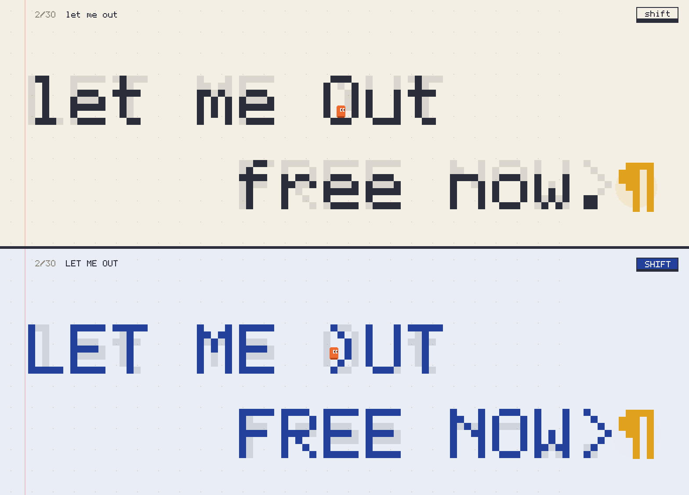

# SHIFT+

A puzzle platformer for GitHub Game Off 2026 (theme: SHIFT). You walk on the words of a letter.
Hold Shift and every character turns into its shifted twin, so the terrain changes under your feet.

**[Play it in your browser](https://maitrungduc1410.github.io/ShiftPlus/)**



*Level 2. Top: you're stuck inside the `0`. Bottom: hold Shift, the `0` becomes `)` and you can walk out.*

## Controls

| Key | Action |
|---|---|
| Arrows / A D | Move |
| Space / W / Z / Up | Jump (hold for higher) |
| Shift (or X / C) | Hold to shift the world |
| Left Shift / X, Right Shift / C | Split levels: shift only the left or right side |
| R | Restart level |
| Esc / P | Pause |
| M | Mute |

## Develop

```bash
npm install
npm run dev        # http://localhost:5173
npm run build      # outputs dist/, zip it and upload to itch.io as an HTML game
npm run levels     # print levels as ASCII (both states)
npm run solve      # prove every level is beatable with the real physics
```

The demo on GitHub Pages is deployed by hand: Actions > Deploy to GitHub Pages > Run workflow.
First time only, set Settings > Pages > Source to "GitHub Actions".

## How levels work

Levels live in `src/levels.ts` as plain text, written in their unshifted state. `¤` marks the spawn,
`¶` the goal. Each character is drawn with the hand-made pixel font in `src/font.ts`, and every
font pixel is a solid tile. Uppercase letters and already-shifted symbols never change, so they are
the fixed parts of a level.

Mechanics so far:

| Unshifted | Shifted | Effect |
|---|---|---|
| `0` | `)` | Cage opens on its left side |
| `` ` `` | `~` | Marks too thin to stand on become a walkable bridge |
| `8` / `6` | `*` / `^` | Safe blocks become spikes |
| `\` | `\|` | Slope becomes a wall |
| `-` | `_` | Bridge drops to the floor line |
| `a`..`z` | `A`..`Z` | Letters grow taller (and lift you) |

Chapter 3 levels are `split: true`. There, Left Shift changes only the characters left of the
player and Right Shift only those to the right. The character under the player never changes, and
there is no "shift everything".

After editing a level, run `npm run solve`. It checks the level is beatable with Shift, and
whether it can be beaten without Shift (which usually means the puzzle doesn't need its mechanic).
The solver models a human: at most one Shift change per jump. Multi-line levels can hit the
default search budget ("gave up" is not the same as "NOT BEATABLE"). Last verified with:

- `MAX_NODES=25000000 npm run solve -- <n>` for 9, 10, 17, 20, 27
- `HEUR=direct MAX_NODES=25000000 npm run solve -- <n>` for 25, 30
- level 29 in overlapping segments: `LEVELS_MODULE=../scripts/lab-levels.ts MAX_NODES=20000000 npm run solve`

For multi-line levels, `scripts/place.py` places pieces at exact character indexes so drops line up.
Watch out for two things the solver keeps catching: falling through a pit onto a lower line next
to the goal, and a `_` floor followed by a 7-tall character (6 tiles is too high to jump).

## Structure

- `src/player.ts` custom tile physics (coyote time, jump buffer, step-up, corner nudge, push-out on shift)
- `src/scenes/GameScene.ts` gameplay, HUD, pause, level-complete flow
- `src/audio.ts` all sound is synthesized with WebAudio (music transposes while Shift is held)
- `src/ui.ts` pixel text, menus, paper background
